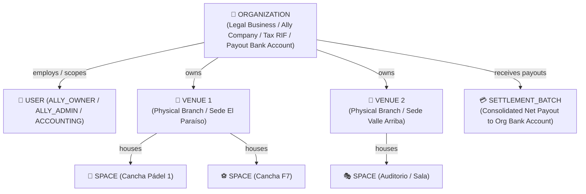

# YoReservo — Backoffice UI Designs & Functional Specifications

This directory contains the functional specifications, information architecture, and interactive HTML/CSS/JS prototypes for the **Unified YoReservo Backoffice**.

---

## 📂 Directory Contents

| File / Folder | Description |
|---|---|
| [`BACKOFFICE_SPECIFICATIONS.md`](./BACKOFFICE_SPECIFICATIONS.md) | **Functional Specification**: Role analysis, A–Y forensic critique of legacy designs, and workflow requirements. |
| [`backoffice_modules.md`](./backoffice_modules.md) | **Module Catalog & Delivery Index**: Full catalog of the 9 Backoffice modules, operational workflows, and verified prototypes. |
| [`claude_comments.md`](./claude_comments.md) | **Architectural Review & Resolution Matrix**: Code quality, domain review, schema critique, and resolution status. |
| [`STYLE_GUIDE.md`](./STYLE_GUIDE.md) | **Design System & Style Rules**: Executive palette, semantic CSS tokens, typography, and responsive rules. |
| [`index.html`](./index.html) | **Master Showcase Portal**: Interactive central portal to browse and launch all 16 Backoffice prototypes. |
| [`404.html`](./404.html) | **Global 404 Error Screen**: Branded error page with quick return navigation. |
| [`agenda/`](./agenda/) | **Module 2**: Hourly timeline grid (`agenda-grid.html`) with zero-fee walk-in drawer and express QR check-in. |
| [`auth/`](./auth/) | **Modules 1 & 9**: Authentication (`login.html`), password recovery (`recover-password.html`), staff invitation (`set-password.html`), and self-service profile (`profile.html`). |
| [`bookings/`](./bookings/) | **Module 6**: Master ledger (`reservations-list.html`) with short-code search, financial breakdown drawer, and WhatsApp launcher. |
| [`catalogs/`](./catalogs/) | **Module 5**: Master taxonomy (`master-catalogs.html`) with 3-tier sports hierarchy, court surfaces, and facility amenities. |
| [`dashboard/`](./dashboard/) | **Module 8**: Executive intelligence console (`executive-dashboard.html`) with role perspective switcher (Global Admin vs Avila Complex Ally). |
| [`treasury/`](./treasury/) | **Modules 3 & 7**: Pago Móvil inbox (`pago-movil-inbox.html`), official BCV rate monitor (`exchange-rate.html`), and bi-weekly settlements (`settlements.html`). |
| [`users/`](./users/) | **Module 5**: RBAC directory (`users-rbac.html`) with decoupled organization/venue authorization scopes and credential generator. |
| [`venues/`](./venues/) | **Module 4**: Physical branches & Organization corporate card (`venues-management.html`), space builder (`spaces-builder.html`), and split-shift schedule editor (`schedules-editor.html`). |
| [`scripts/`](./scripts/) | Prototype test suite ([`check-prototypes.js`](./scripts/check-prototypes.js)) for syntax, i18n parity, and link validation. |

---

## 🏛️ 3-Tier Enterprise Architecture (Multi-Vertical Ready)

The backoffice UI prototypes and database schema ([`database/proposed_db.mermaid`](../database/proposed_db.mermaid)) adhere to a decoupled 3-tier domain model that scales beyond sports courts into event halls, auditoriums, and academies:



1. **`ORGANIZATION`**: Represents the commercial Ally business partner (legal name, corporate tax RIF, payout bank account, commission rate %).
2. **`VENUE`**: Represents a physical facility/branch (`organization_id`, address, GPS, local operating hours).
3. **`SPACE`**: Multi-purpose operational resource (sports courts, halls, presentation rooms, stages) with capacity, surface type, and custom hourly pricing.
4. **`SPACE_BLOCK`**: Dedicated entity for blocking time intervals (maintenance, rain, private tournaments) without polluting customer reservations.
5. **Decoupled RBAC**: Users can have Organization-level scope (`ALLY_OWNER`, `ACCOUNTING`) or Venue-specific scope (`ALLY_ADMIN`, `VALIDATOR`).

---

## 🎨 Design System & Visual Standards

All prototypes in this directory follow **YoReservo's** official brand standards:

### 1. Typography
- **Headings & Branding**: `Outfit` (600, 700, 800) — Athletic, modern, and prominent.
- **Body, Tables & Forms**: `Inter` (400, 500, 600, 700) — Precision and clarity in data-dense interfaces.

### 2. Institutional Color Palette (CSS Tokens)
```css
:root {
  /* Backgrounds & Surfaces */
  --bg-main: #F7F5EF;          /* Soft institutional backdrop */
  --bg-surface: #FFFFFF;       /* Cards and elevated surfaces */
  --bg-muted: #F0EDE5;         /* Secondary surfaces, inputs */
  --border: #E6E2D8;           /* Subtle borders */
  
  /* Text */
  --text-main: #1F290F;        /* Deep olive-green (near black) */
  --text-muted: #636C59;       /* Secondary text / placeholders */
  
  /* Brand Identity */
  --brand-deep: #1F290F;       /* Institutional deep forest olive */
  --brand-accent: #C6F23B;     /* Vibrant electric lime (athletic energy) */
  --brand-accent-hover: #b5e327;
  
  /* Operational Statuses */
  --status-available-bg: #ECFDF5;
  --status-available-text: #059669;
  --status-hold-bg: #FEF3C7;
  --status-hold-text: #D97706;
  --status-confirmed-bg: #EFF6FF;
  --status-confirmed-text: #2563EB;
  --status-completed-bg: #F3E8FF;
  --status-completed-text: #7C3AED;
  --status-cancelled-bg: #FEE2E2;
  --status-cancelled-text: #DC2626;
  --status-blocked-bg: #F1F5F9;
  --status-blocked-text: #64748B;
}
```

---

## 🚀 How to View the Designs
All prototypes are **self-contained HTML5/CSS3/Vanilla JS files** with zero build dependencies:
1. Open any `.html` file directly in **Google Chrome**.
2. Each screen features realistic interactivity (status switching, filters, modals, and time-slot selection).

---

## ✅ Validating the Prototypes
Run the static checker (Node 18+, no dependencies) after editing any screen:
```bash
node scripts/check-prototypes.js          # add --unused to also list unused i18n keys
```
It fails (exit code 1) on: inline-script **syntax errors**, `data-i18n` keys **missing** in `es`/`en` or **out of parity** between them, and **broken relative links** (`href` / `src` / `url()`).

